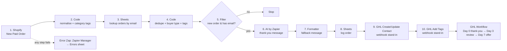
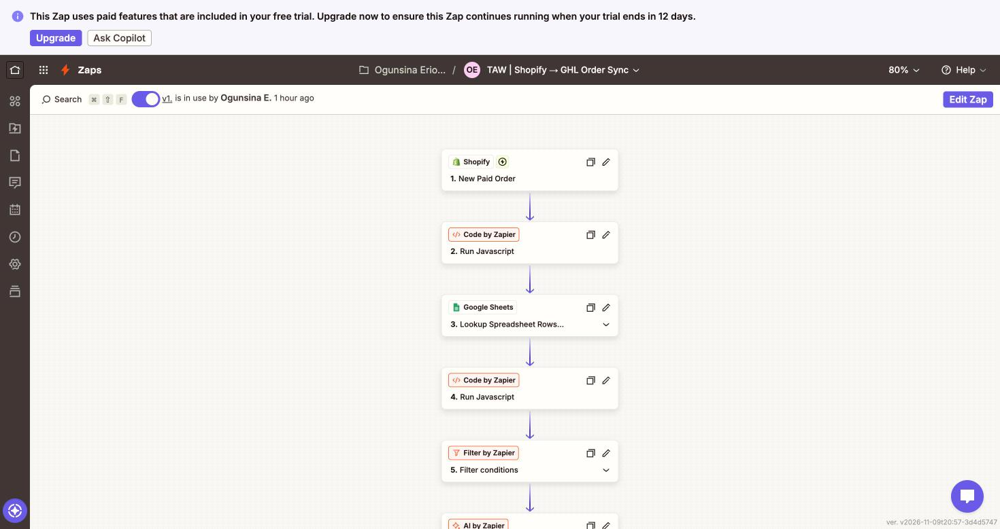
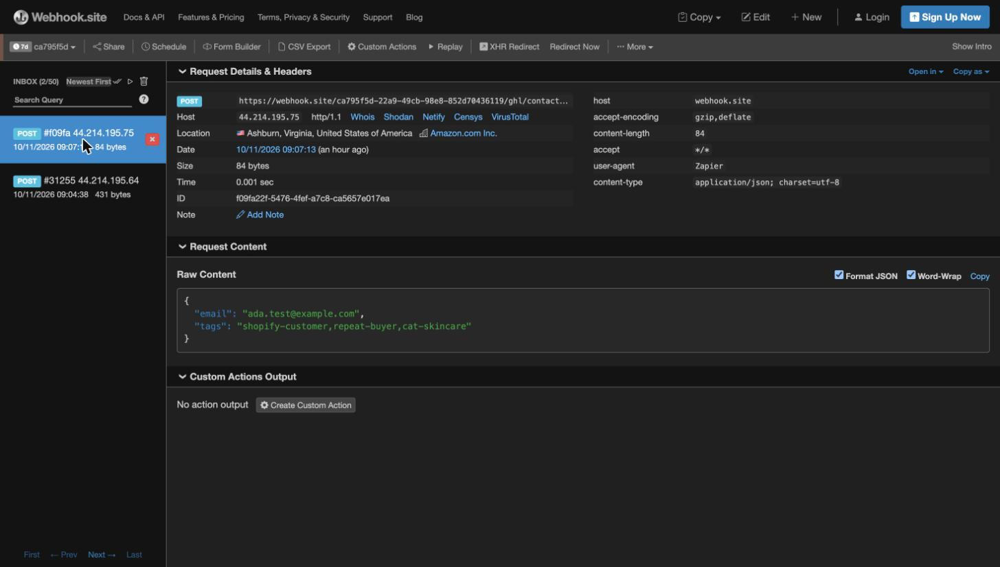

# Shopify → GoHighLevel Customer & Order Sync

> 🎥 **Loom demo (60–90s):** [Watch the demo](https://www.loom.com/share/5dca30c004434c25a2134a7610d14596) (silent walkthrough)
> 📦 **Exported workflow + recorded run:** see [`/workflow`](./workflow)

> **Build status:** The Zap is live with all 10 steps tested. I couldn't create a GHL account because my card was blocked, so the two GHL steps are built as API-equivalent webhook stand-ins. They send the exact contact and tag payloads to a request inspector (webhook.site), and the swap to the real LeadConnector steps is documented in [`docs/zap-blueprint.md`](./docs/zap-blueprint.md#steps-910-ghl-stand-in). The GHL workflow is specified in [`docs/ghl-workflow.md`](./docs/ghl-workflow.md).

## Problem
Shopify stores collect customer and order data but rarely use it for follow-up marketing. Buyers get a receipt and nothing else: no thank-you, no review request, no repeat-purchase offer. Store owners using GoHighLevel (GHL) end up copying contacts across by hand, or not at all.

## Who it's for
Small and mid-size e-commerce brands on Shopify that use GoHighLevel for CRM, email/SMS and automation, and agencies managing GHL for those brands.

## What it does
Every paid Shopify order is synced to GHL within minutes. The customer is created or updated as a GHL contact, tagged by buyer type, order value and product category, given an AI-written personalised thank-you message, and enrolled in a post-purchase nurture flow.

## Features
- **Order trigger:** Zapier fires on every new paid Shopify order
- **GHL contact + tags:** create-or-update by email (no duplicates), tags for `shopify-customer`, `first-time-buyer` / `repeat-buyer`, `high-value`, and product category
- **AI personalisation:** OpenAI writes a short thank-you + cross-sell line from the items bought, stored in a GHL custom field
- **Post-purchase flow:** GHL workflow sends thank-you → review request (day 3) → offer (day 7), branching for first-time vs repeat buyers
- **Order log:** every order written to Google Sheets (used for repeat-buyer detection and deduplication)
- **Error handling:** dedupe on order ID, retries via Zapier Autoreplay (paid plans), failed runs logged to an Errors sheet by a Zapier Manager error Zap, fallback message if OpenAI fails

## Stack
Zapier · GoHighLevel (LeadConnector) · Shopify · Google Sheets / Gmail · OpenAI

## Architecture

## Setup
1. **Shopify:** create a development store, add sample products, and place test orders using Shopify's Bogus Gateway (see `sample-data/`).
2. **Google Sheets:** create a sheet with two tabs, `Orders` and `Errors`, using the headers in `sample-data/orders-sheet-template.csv` and `sample-data/errors-sheet-template.csv`.
3. **GoHighLevel:** in a test sub-account, create the custom fields and tags listed in `docs/zap-blueprint.md`, then build the workflow in `docs/ghl-workflow.md`.
4. **Zapier:** connect Shopify, LeadConnector (GHL), Google Sheets, Gmail and OpenAI, then build the Zap step by step from `docs/zap-blueprint.md`.
5. Copy `.env.example`, fill in your values (these document the config; secrets live in Zapier connections, never in this repo).
6. Turn on the error-logger Zap, turn on Autoreplay in Zapier settings (paid plans), then turn the main Zap on.
7. Place a test order and confirm the contact, tags, custom field, Sheets row and workflow enrolment in GHL.

## Testing
See [`tests/test-checklist.md`](./tests/test-checklist.md).

## Screenshots

## Data & privacy
Sample data only. All customers, emails and phone numbers are fictional. No API keys or secrets are committed.
